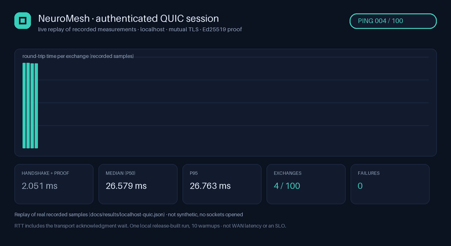
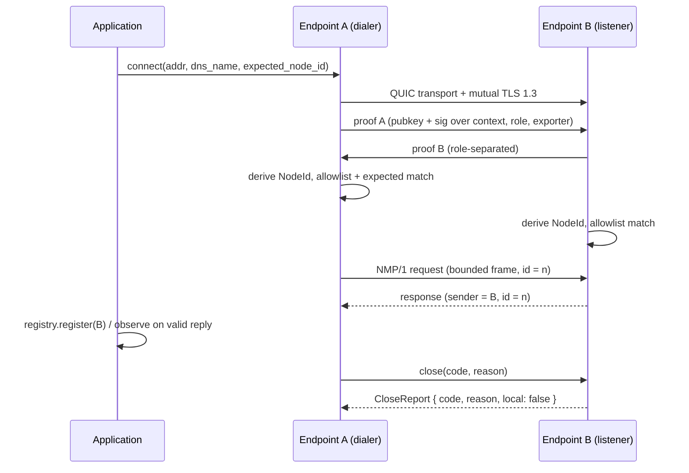
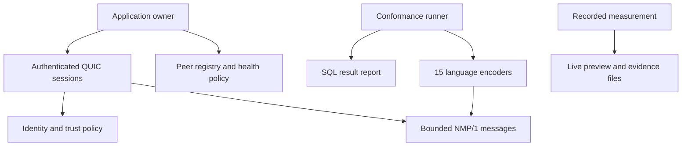

# NeuroMesh

**Secure peer communication and deterministic mesh foundations.**

[](https://github.com/krishanth7/neuromesh/actions/workflows/ci.yml)
[](https://github.com/krishanth7/neuromesh/actions/workflows/interop.yml)
[](LICENSE)

NeuroMesh is an experimental distributed-systems project built around authenticated
QUIC sessions, bounded protocol messages, and explicit peer health policies: a
Rust workspace that establishes mutual-TLS 1.3 connections, proves the application
identity of each peer against an explicit allowlist, exchanges strictly bounded
NMP/1 control messages, and tracks peer health as a pure, testable state machine.
A **17-language interoperability and reporting toolkit** proves that fleets of
heterogeneous services can speak the same wire format. Planned adaptive behavior
uses graph algorithms and scheduling heuristics; the project does not implement
AGI, pretrained models, or hosted inference.

[Live preview](#live-preview) · [What it is for](#what-it-is-for) ·
[What works today](#what-works-today) · [How a session works](#how-a-session-works) ·
[Quick start](#quick-start) · [Measured results](#measured-results) ·
[Architecture](#architecture) · [17 languages](#the-17language-toolkit) ·
[Verification](#verification-and-evidence) · [Security](#security-and-operational-expectations) ·
[Roadmap](#engineering-roadmap) · [Language toolkit](interop/README.md)

> **Status: experimental libraries and developer tooling.** Automatic discovery,
> heartbeat scheduling, adaptive routing, distributed task execution, and a live
> production dashboard remain on the [roadmap](ROADMAP.md). There is no
> autonomous mesh CLI, production deployment, or production-readiness claim.

## Live preview



**What the animation shows, in real time.** Every bar is one round trip from the
recorded experiment in
[docs/results/localhost-quic.json](docs/results/localhost-quic.json) — two
exchanges per frame, drawn left to right as the run happened. The running
**median** and **p95** counters are recomputed live from the samples already on
screen using the nearest-rank definition the recording itself used, so at 100/100
they land exactly on the recorded 26.581 ms and 26.880 ms. The two near-invisible
gaps are the two genuinely fast exchanges in that run (0.093 ms and 0.210 ms);
nothing is synthetic, and the page and animation open no sockets. The script that
draws it, [scripts/render_preview_gif.py](scripts/render_preview_gif.py), reads
the evidence file directly and fails if it does not contain exactly the recorded
100 samples, so the animation can never drift from the data.

**Watch it interactively.** The same session is presented by a self-contained
dashboard with play/pause controls, the delivered-vs-roadmap capability matrix,
the authentication lifecycle, and the peer health state machine:

```sh
bash scripts/serve_preview.sh 3000     # then open http://localhost:3000/
```

**Run it live yourself.** The preview replays a recorded run; the real thing runs
on your loopback in seconds:

```sh
# One fresh authenticated run, printed in real time (release build):
cargo run --locked --release -p neuromesh-network --example measure_quic
# Or regenerate and record the evidence file used above:
python3 scripts/record_measurement.py
```

## What it is for

| You want | NeuroMesh today gives you |
|---|---|
| An authenticated control channel between services you operate | Mutual TLS 1.3 with certificate **and** Ed25519 application-identity checks against an explicit allowlist, bound to the TLS session so a proof cannot be replayed across sessions |
| Messages that cannot become unbounded | 64 KiB hard frame ceiling, strict JSON with unknown/duplicate field rejection, recursion limits, connection, stream, queue, and deadline caps enforced in code |
| Peer status you can reason about | A pure registry: monotonic time in, explicit health transitions out, no hidden timers, no implicit eviction |
| Proof that other languages speak your protocol | 15 executable encoders validated byte-for-byte by the actual Rust decoder, reported through SQL, orchestrated by Bash |
| Evidence rather than adjectives | A checked-in raw measurement (samples, commands, versions, source hashes) that you can rerun |

**When not to use it:** anything production-facing (no audit, no releases, no
Internet DoS guarantee), anything needing discovery, routing, or task execution
(these are roadmap items), or anything needing a supported non-Rust client
runtime — the polyglot encoders are conformance examples, not SDKs.

## What works today

| Capability | Component | Delivered behavior | Verified by |
|---|---|---|---|
| Identity | `neuromesh-core` | Ed25519 signing, strict verification, domain-separated BLAKE3 node fingerprints, zeroized generated seeds, no `Debug`/serialization for secret keys | Tampering, fingerprint, and zeroization-adjacent unit tests |
| Secure transport | `neuromesh-network` | Mutual TLS 1.3, hostname checks, explicit identity allowlists, session-bound exporter proofs with role separation, no 0-RTT | Real localhost QUIC tests covering trusted, untrusted-cert, wrong-hostname, unlisted, and wrong-expected-identity paths |
| Resource boundaries | both | Connection caps including in-flight handshakes, handshake/request deadlines, single-operation admission, bounded windows, 64 KiB envelopes | Cap-release, timeout, and bounded-writer tests |
| NMP/1 protocol | `neuromesh-protocol` | Versioned control messages, strict decode/encode, sender and request-ID checks, stable error codes on the wire and in logs | Round-trip, boundary, truncation-at-every-split, corruption, and recursion-limit tests |
| Peer registry | `neuromesh-core` | Bounded membership (1–1024), duplicate/self/capacity rejection without state mutation, monotonic health transitions, explicit removal, read-only statistics | Deterministic state-machine invariants plus authenticated registration over real QUIC |
| Configuration | `neuromesh-core` | Strict JSON documents: required fields, unknown-field rejection, integer milliseconds, validated in the same call that parses them | Decode-and-validate test matrix |
| Session lifecycle | `neuromesh-network` | Explicit close with bounded code/reason observable by the peer, classified request failures (timeout vs. protocol vs. transport), counter snapshots | Close-report and deadline tests over real QUIC |
| Interoperability | `interop/` | 15 executable Ping encoders, Rust decoder oracle, SQL aggregation, Bash automation across 17 languages | 570 / 570 recorded conformance cases |
| Measurement | `scripts/`, `neuromesh-network` | Real localhost QUIC experiment with raw samples, commands, versions, and SHA-256 source hashes | Checked-in evidence you can rerun |
| Live preview | `docs/preview/` | Self-contained dashboard replaying the recorded session with live counters | Served HTTP 200 with the recorded data embedded verbatim |

## How a session works

One connection, end to end, as executed by the recorded run and asserted by the
integration suite:

| Phase | What happens | Evidence |
|---|---|---|
| 1. Bind | Endpoint configures TLS 1.3-only QUIC with certificate chain, private key, trust roots, ALPN `nmp/1`, and a connection cap | `MeshEndpoint::bind`, rejects caps outside 1–1024 |
| 2. Dial | Caller supplies address, DNS name, and the **expected** NodeId; unlisted identities are refused before any I/O | Allowlist test: dial fails with zero handshakes attempted |
| 3. Handshake | QUIC transport + mutual TLS: both sides present certificates, client verifies the hostname | Trusted and untrusted-certificate tests |
| 4. Identity proof | Each side sends 96 bytes (Ed25519 public key + signature) over the **first** stream, signing context, role byte, and 32 bytes derived from the TLS exporter — a proof bound to this exact session, useless if replayed | Proof unit tests: wrong binding, wrong role, unlisted key all rejected |
| 5. Authorize | Derived NodeId must be on the allowlist; the initiator must also match the expected NodeId exactly | Wrong-expected-identity test |
| 6. Exchange | Each request opens one bounded stream: length-prefixed envelope out, matching envelope back; sender and message-ID must match the authenticated peer; one operation at a time per session | 100/100 recorded exchanges; replay and mismatch tests |
| 7. Register | Only now may the peer enter the registry (`Session::peer()`), and only a valid response refreshes its observation | Authenticated-registration integration test |
| 8. Close | Explicit application close carries a code and reason the peer observes; dropping the session closes with code 0 and releases capacity | Close-report test: code 42 `maintenance window` observed by the peer |



**Why the recorded exchange is ~26 ms on localhost.** Each measured round trip
includes the transport's acknowledgment wait, not just serialization: the client
sends, the server answers, and the client waits for QUIC's acknowledgment
path. The project reports this rather than hiding it — the number is honest and
the transport behavior is worth profiling, which is why it is stated in the
[results interpretation guide](docs/results/README.md) as well as here.

## Quick start

Requirements for the core: Rust stable, Cargo, rustfmt, Clippy, and Python 3.

```sh
git clone https://github.com/krishanth7/neuromesh.git
cd neuromesh
cargo build --locked --workspace --all-targets
cargo test --locked --workspace --all-features
cargo fmt --all -- --check
cargo clippy --locked --workspace --all-targets --all-features -- -D warnings
python3 scripts/check_links.py
```

Run real authenticated transport and registry integration tests:

```sh
cargo test --locked -p neuromesh-network --test quic
```

Run the complete polyglot pipeline after installing the
[documented language runtimes](interop/README.md):

```sh
bash scripts/verify.sh
```

Preview and regenerate the evidence:

```sh
bash scripts/serve_preview.sh 3000                       # live dashboard
python3 scripts/record_measurement.py                    # refresh recorded QUIC evidence
python3 scripts/render_preview_gif.py                    # redraw the README animation from evidence
```

## Measured results

The checked-in evidence records actual executions in a Linux x86_64 development
environment on 22 September 2026. Conformance inputs are boundary-test vectors,
not production traffic. Results apply to the recorded source hashes and environment.

| Verification | Observed result |
|---|---|
| Rust unit and integration suite | 26 passed, 0 failed |
| NMP/1 encoders | 570 / 570 cases passed across 15 encoders (38 each) |
| SQL reporting | Aggregates checked against observed per-case outcomes |
| Formatting, Clippy, documentation, links | All passed via `bash scripts/verify.sh` |

### Authenticated localhost QUIC

Two endpoints run in one process with ephemeral test certificates, mutual TLS,
and Ed25519 proofs. One established session exchanges 10 warmup pings followed by
100 sequential measured pings. Each Pong's nonce is checked. The authenticated
peer is registered and refreshed after valid responses.

| Metric | Recorded value |
|---|---:|
| Measured successful exchanges | 100 / 100 |
| Handshake including identity proof | 2.051 ms |
| Request/response p50 | 26.581 ms |
| Request/response p95 | 26.880 ms |
| Minimum / maximum | 0.093 / 27.268 ms |

These timings **include the transport's acknowledgment wait**. They are one local
run, not WAN latency, a throughput benchmark, a service-level objective, or an
optimized latency claim. There is no CPU isolation or multi-machine load test.

[Raw samples and provenance](docs/results/localhost-quic.json) ·
[570 conformance outcomes](docs/results/interop.json) ·
[Reproduction and interpretation](docs/results/README.md) ·
[Full verification transcript](docs/results/verification.txt)

```sh
python3 scripts/record_measurement.py
# Or print one fresh run without updating the recorded evidence:
cargo run --locked --release -p neuromesh-network --example measure_quic
```

## Architecture



### Crates

| Crate | Role | Key types | Does not do |
|---|---|---|---|
| `neuromesh-core` | Pure contracts: identity, configuration, lifecycle, registry | `Identity`, `NodeId`, `NodeConfig`, `Lifecycle`, `PeerRegistry`, `RegistryStats` | No sockets, no timers, no I/O of any kind |
| `neuromesh-protocol` | Bounded, versioned NMP/1 encoding | `Envelope`, `Message`, `PeerHint`, `ProtocolError` (stable codes) | No transport, no authentication |
| `neuromesh-network` | Authenticated QUIC sessions | `MeshEndpoint`, `Session`, `Credentials`, `EndpointMetrics`, `CloseReport` | No discovery, no registry ownership, no scheduling |

### NMP/1 message types

| Type | Body | Validation |
|---|---|---|
| Hello | agent | 1–64 UTF-8 bytes, no control characters |
| Ping / Pong | nonce | u64, echoed exactly; caller matches the outstanding probe |
| GetPeers | absent | no payload |
| Peers | peers | ≤ 64 hints, nonzero port, no unspecified/multicast addresses |
| Error | code, detail | reserved categories 1–4 (frame-size, encoding, version, validation), detail ≤ 256 bytes, no control characters |

Full specification: [docs/protocol/NMP-1.md](docs/protocol/NMP-1.md).

### Registry contract

| Rule | Behavior |
|---|---|
| Capacity | 1–1024 peers; hitting capacity fails without mutation; unavailable peers keep their slot until explicitly removed |
| Time | Caller supplies monotonic `Instant` everywhere; backwards time is rejected atomically |
| Health | Healthy → Suspect (`age ≥ suspect_after`) → Unavailable (`age ≥ unavailable_after`); a valid observation restores Healthy |
| Trust | Register only authenticated `Session::peer()` values; discovery hints are never trusted peers |
| Reads | Ordered iteration and read-only statistics; no hidden eviction or background tasks |

Decision records: [ADR 0001](docs/architecture/0001-foundation.md) ·
[ADR 0002](docs/architecture/0002-identity.md) ·
[ADR 0003](docs/architecture/0003-quic.md) ·
[ADR 0004](docs/architecture/0004-peer-registry.md) ·
and the full index in [ARCHITECTURE.md](ARCHITECTURE.md).

## The 17-language toolkit

**Rust, Python, JavaScript, TypeScript, Go, C, C++, Java, C#, Ruby, PHP, Perl,
Lua, R, Haskell, SQL, and Bash.**

| Language | Role | Language | Role |
|---|---|---|---|
| Rust | Core, transport, decoder, reference encoder | Ruby | Arbitrary-precision encoder |
| Python | Encoder, conformance runner, provenance | PHP | Unsigned-decimal-preserving encoder |
| JavaScript | Node encoder with lossless u64 tokens | Perl | Lexical bounds-check encoder |
| TypeScript | Typed Node encoder (native type stripping) | Lua | Encoder avoiding float conversion |
| Go | Standalone compiled encoder | R | Full-u64-preserving encoder |
| C | Dependency-free encoder, checked hex input | Haskell | Arbitrary-precision encoder |
| C++ | Standard-library encoder | SQL | Result schema and per-language aggregation |
| Java | JVM encoder | Bash | Fail-fast build/lint/test/conformance pipeline |
| C# | Mono-compatible encoder | | |

The first 15 provide compatible Ping encoders; Rust additionally implements the
secure transport and protocol decoder. SQL stores and summarizes actual test
outcomes, while Bash orchestrates validation. These are focused integration
examples, **not 17 separate mesh runtimes or production SDKs**. Markup and
configuration files are not counted. Full inventory, contract, and commands:
[interop/README.md](interop/README.md).

## Verification and evidence

| Command | What it proves |
|---|---|
| `cargo fmt --all -- --check` | Canonical formatting gate (the gate that caught the last regression before CI did) |
| `cargo clippy --locked --workspace --all-targets --all-features -- -D warnings` | Lint-clean at zero-warning policy, all targets |
| `cargo test --locked --workspace --all-features` | Unit, protocol, and real-localhost-QUIC integration suites |
| `RUSTDOCFLAGS='-D warnings' cargo doc --locked --workspace --no-deps` | Every public item documented, links resolve |
| `python3 scripts/check_links.py` | Every relative Markdown link resolves |
| `python3 scripts/check_interop.py` | All 15 encoders × 38 cases validated by the real decoder, SQL aggregates checked; missing runtimes reported per language with exit 2 |
| `bash scripts/verify.sh` | The whole pipeline in one fail-fast entry point |
| `python3 scripts/record_measurement.py` | One real transport run, recorded with provenance |

Recorded outputs live in [docs/results](docs/results/README.md); CI re-runs the
Rust and interoperability workflows on every pull request, and PR titles are
linted for the conventional commit format.

## Security and operational-expectations

- Review [SECURITY.md](SECURITY.md) before use: supported-versions table,
  severity tiers, threat model with residual risks, and reporting route.
- Test identities and ephemeral certificates are for localhost verification only.
- Never commit private keys, seeds, credentials, or real deployment secrets.
- Node IDs supplied to encoders are untrusted claims until authenticated by the
  transport. Discovery is not authorization.
- The project has not been independently audited; there is no Internet DoS
  guarantee and no task sandbox.

[Contributing](CONTRIBUTING.md) · [Code of conduct](CODE_OF_CONDUCT.md) ·
[Support](SUPPORT.md) · [Changelog](CHANGELOG.md)

## Engineering roadmap

Intent, not delivered features or promised dates — full detail in
[ROADMAP.md](ROADMAP.md).

| Phase | Target | Scope | Status |
|---|---|---|---|
| 0–1 | v0.1.0 Foundation | Workspace, CI, policies, identity, lifecycle | Delivered in `main` (release draft unpublished) |
| 1 | v0.2.0 Connected Nodes | NMP/1, QUIC, registry | Delivered in `main` |
| 2 | v0.3.0 Mesh Discovery | LAN discovery, bootstrap, heartbeat | Pending |
| 3–4 | v0.4.0 Adaptive Routing | Graph, scoring, recovery | Pending |
| 5 | v0.5.0 Distributed Compute | Tasks, deterministic placement, retries | Pending |
| 6 | v0.6.0 Observatory | Metrics, API, dashboard | Pending (this repository ships recorded evidence and a static preview only) |
| 7 | v0.7.0 Hardened Mesh | Simulation, benchmarks, security review | Pending |

## License

[Apache License 2.0](LICENSE).

Designed for Developers